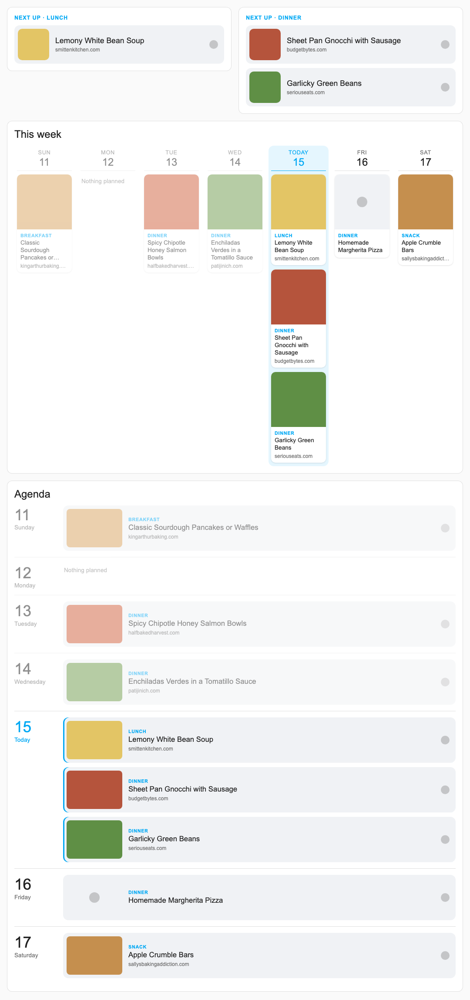

# Samsung Food for Home Assistant

An unofficial custom integration that uses the same gRPC-Web API as app.samsungfood.com. It adds:

| Entity | What it is |
| --- | --- |
| `todo.samsung_food_<list name>` | One to-do list per Samsung Food shopping list. You can add, check off, rename and delete items. |
| `calendar.samsung_food_meal_plan` | Meal plan as all-day events, e.g. "Dinner: Salmon Bowls", with the recipe link in the description. |
| `sensor.samsung_food_meal_plan` | State is today's meals. The `meals` and `next_week_meals` attributes hold each meal's date, weekday, meal time, name, image and links: `url` (Samsung Food page), `source_url` (original site, if any) and `link` (the original if there is one, else the Samsung Food page). Weeks start on Sunday, like the app. |

It polls every 5 minutes, and refreshes right away after you change the list from Home Assistant.

## Install

**HACS (custom repository):** in HACS, open the menu → Custom repositories, add this repo's URL with type "Integration", then install "Samsung Food".

**Manual:**

1. Copy `custom_components/samsung_food` into your Home Assistant `config/custom_components/` folder.
2. Restart Home Assistant.
3. Go to **Settings → Devices & services → Add integration → Samsung Food** and sign in with your email and password.

**How login works:** the integration stores your email and password, and an access token in the config entry.
- When the token expires or is rejected, it logs in again automatically.
- If the password itself stops working, Home Assistant shows a "Reconfigure" prompt.

## Meal plan card

The integration includes a dashboard card, `custom:samsung-food-meal-plan-card`. It loads automatically, so you don't need HACS or a dashboard resource. Restart Home Assistant after installing or updating, then refresh the dashboard. On a wall display, you may need to clear the kiosk browser's cache.

To add it, choose **Add card** and search for "Samsung Food meal plan". Every option can be set in the visual editor.



**Layouts:**
- `week`: the week strip. One column per day, today highlighted and earlier days dimmed. Works well full-width on a portrait wall display.
- `agenda`: one row per day with larger recipe cards.
- `next`: a small card with the next meal(s) still to come today.

**How the `next` layout picks meals:**
- Breakfast is shown until 11:00, lunch until 15:00, and dinner for the rest of the day. Change the cutoffs with `breakfast_until` and `lunch_until`.
- It shows the earliest slot that still has meals, so with no lunch planned you see dinner at 11:00.
- If a slot has several meals, they're all shown.
- Meals without a breakfast, lunch or dinner slot (snacks, or meals with no meal time set) only show once no slotted meals are left today.
- When nothing is left, it shows "No More Meals".

Tapping a meal opens `link` in a new tab: the original recipe site, or the Samsung Food page.

```yaml
# Full-width week strip
type: custom:samsung-food-meal-plan-card
entity: sensor.samsung_food_meal_plan
layout: week            # week | agenda | next
title: This week
week: this              # this | next  (week and agenda layouts)
show_images: true
show_past_days: true    # false hides earlier days this week
show_source: true
```

```yaml
# Small "next meal" card
type: custom:samsung-food-meal-plan-card
entity: sensor.samsung_food_meal_plan
layout: next
breakfast_until: "11:00"
lunch_until: "15:00"
```

Kiosk browsers: if tapping a meal does nothing, allow links to open in a new window. In Fully Kiosk, that's Web Content Settings → Open URLs in a new tab/window.

## Markdown card (alternative)

```yaml
type: vertical-stack
cards:
  - type: markdown
    title: This week's meals
    content: >
      
      
      **{{ items[0].weekday }}**
      
      - {{ m.meal_time }}: [{{ m.name }}]({{ m.link }})
      
      
      Nothing planned this week.
      
  - type: todo-list
    entity: todo.samsung_food_groceries   # use your list's entity ID
```

- Tapping a meal opens the original recipe site, or the Samsung Food page if the recipe has no source (e.g. one you typed in yourself). Use `m.url` instead of `m.link` to always open Samsung Food.
- The to-do list card adds items through an "Add item" box. Samsung Food parses text like "2 lbs chicken" into a quantity and unit.
- You can also add items by voice with Assist ("add pears to my groceries list"), or with the `todo.add_item` action in automations.

## Notes and limits

- **Not affiliated with Samsung.** This project isn't made or endorsed by Samsung.
- **Unofficial API.** It could change without notice. The schemas came from web app version 2.89.0. If something breaks, check *Settings → System → Logs* for `samsung_food`.
- **Testing:**
  - Reading lists, reading the meal plan and adding an item were tested against the live service.
  - Checking off, renaming and deleting items were only tested against a fake server, built to the request formats in the web app's code.
  - Login was tested against the live service with a made-up account. Your real account hasn't been tried yet.
- **Quantities:** they show as the to-do item's description, e.g. "2 l". The description can't be edited from Home Assistant.
- **Meal plan scope:** it reads your own meal plan. Shared or template plans aren't covered.
- **New lists** show up automatically within 5 minutes. A deleted list's entity becomes unavailable and can be removed.

The reverse-engineered API details are in [docs/api-notes.md](docs/api-notes.md).

## Tests

`card_tests/` checks the card in headless Chromium: the next-meal rules and all three layouts. Run `python test_card.py <dir>` to also save screenshots.

```bash
uv venv --python 3.13 .cardvenv && uv pip install --python .cardvenv/bin/python pytest playwright && .cardvenv/bin/python -m playwright install chromium
```

```bash
cd card_tests && ../.cardvenv/bin/python -m pytest -q
```

`tests/` runs the integration against a fake Samsung Food server:

```bash
uv venv --python 3.13 .venv && uv pip install --python .venv/bin/python pytest-homeassistant-custom-component
```

```bash
cd tests && PYTHONPATH=.. ../.venv/bin/python -m pytest -q
```
